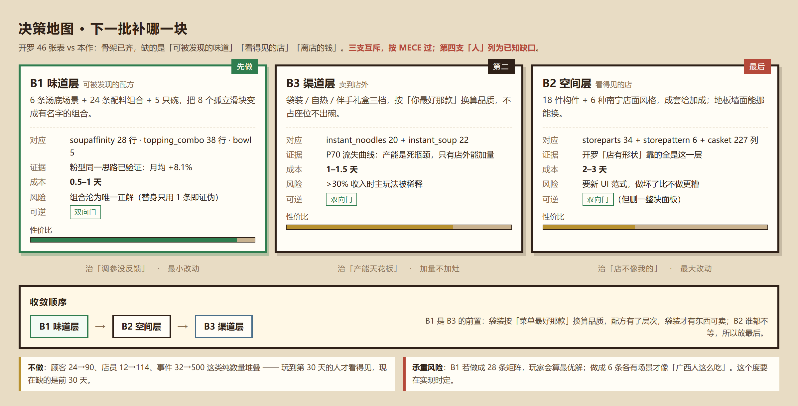

# 决策卡 · 下一批补哪一块（2026-11-20）

**结论**：先做 **B1 味道层**（0.5–1 天）→ **B3 渠道层**（1–1.5 天）→ **B2 空间层**（2–3 天）。三支都是双向门，可随时回退。

| | 一句话 | 对应开罗 | 成本 | 风险 |
|---|---|---|---|---|
| **B1 味道层** ★ | 6 条汤底场景 + 24 条配料组合 + 5 只碗，把 8 个孤立滑块变成有名字的组合 | soupaffinity 28 · topping_combo 38 · bowl 5 | 0.5–1 天 | 组合沦为唯一正解 |
| **B3 渠道层** | 袋装 / 自热 / 伴手礼盒，按最好那款配方换算品质，不占座位 | instant_noodles 20 + instant_soup 22 | 1–1.5 天 | 收入 >30% 时主玩法被稀释 |
| **B2 空间层** | 18 件构件 + 6 种南宁店面风格，成套给加成 | storeparts 34 + storepattern 6 + casket | 2–3 天 | 要新 UI 范式，做坏更糟 |

**为什么这个顺序**：B1 成本最低且治「调参没反馈」最准（粉型同一思路已验证 +8.1%）；B3 是唯一能加营收而不加产能负担的（P70 证明产能是死瓶颈），但它是 B1 的下游 —— 配方有层次，袋装才有东西可卖；B2 最贵且不等任何人，放最后。

**不做**：顾客 24→90、店员 12→114、事件 32→500 这类纯数量堆叠 —— 玩到第 30 天才看得见，而现在的病在前 30 天。

**承重问题**：B1 做成 28 条矩阵，玩家会算最优解；做成 6 条各有场景才像「广西人这么吃」。这个度在实现时定。

> 置信度 **HIGH（85）**。过程件见 `docs/GAP-开罗全表对照-2026-11-20.md` 与 `docs/缺口方案与决策地图-2026-11-20.md`。
